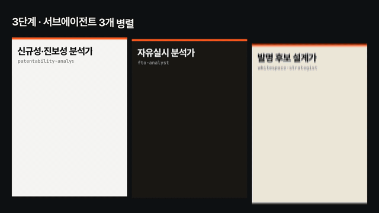
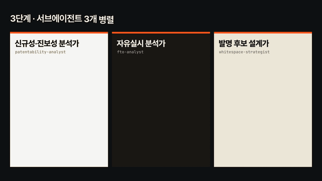
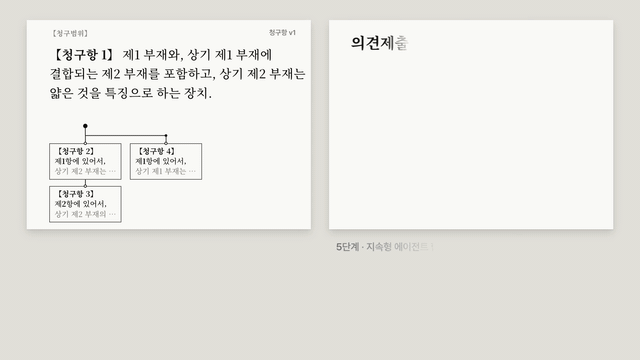
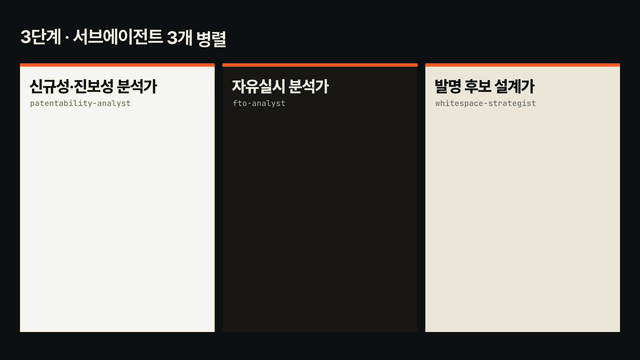
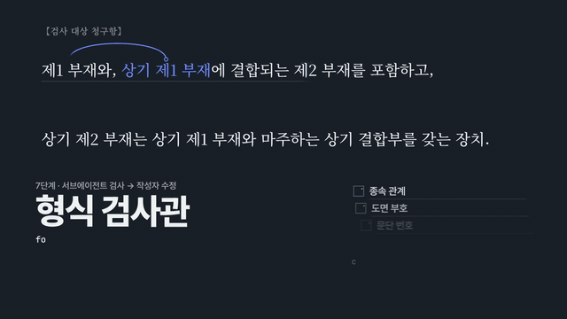
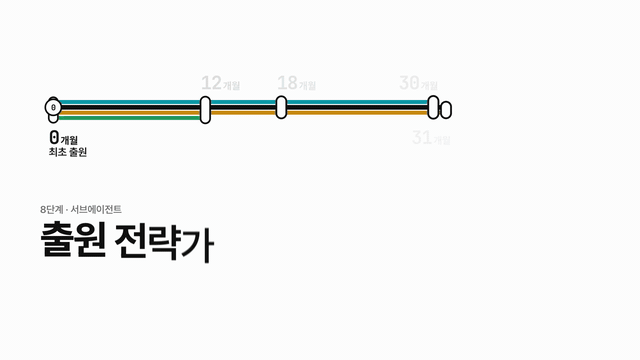
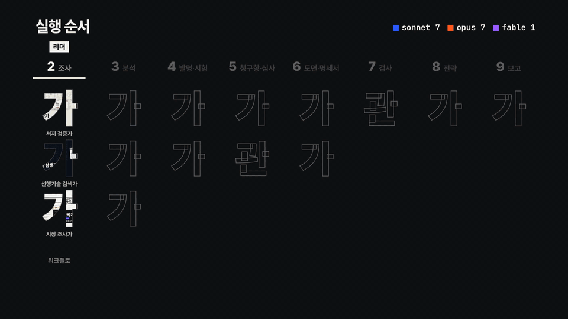

<div align="center">

# patent-harness

**아이디어 메모나 선행조사 보고서를 넣으면, Claude Code 에이전트 15개가 특허 출원 준비 서류 8종을 만든다.**

선행기술 검증 · 신규성·진보성 판단 · 자유실시 분석 · 발명신고서 · 청구항 · 모의 심사 · 명세서·도면 · 형식 검사 · 출원 일정표


| 에이전트 | 스킬 | 실행 단계 | 수집·검사 스크립트 | 최종 산출물 |
| :---: | :---: | :---: | :---: | :---: |
| **15** | **11** | **0~9단계** | **4** | **8종** |

</div>

## 청구항을 쓰는 에이전트와 거절하는 에이전트가 따로 있다

LLM 하나에게 "청구항 써 줘"라고 하면 청구항 문체를 갖춘 문장이 나온다. 그 문장이 선행문헌을 피하는지, '상기'마다 앞에 근거가 있는지, 심사관이 어떤 조문으로 거절할지는 따로 확인하지 않으면 알 수 없다. 이 하네스는 그 확인을 맡을 에이전트를 따로 두었다.

| 기존 방식에서 빠지는 확인 | 이 하네스에서 맡는 쪽 |
| --- | --- |
| 조사 보고서에 적힌 특허 번호·출원인·법적 상태가 맞는가 | **서지 검증가**가 Google Patents 원문과 항목별로 대조하고, `일치`가 아닌 판정은 다른 검증가가 1차 판정이 틀렸을 가능성부터 다시 확인한다 |
| 보고서 요약이 청구 범위를 실제보다 넓게 적지 않았는가 | 청구항 1과 초록을 기준으로 대조해, 실시예에만 있는 내용을 청구 범위처럼 적었으면 `불일치(범위 과장)`로 표시한다 |
| 이 청구항이 실제 심사에서 어떤 이유로 거절될 수 있는가 | **모의 심사관**이 의견제출통지서 형식으로 거절 이유를 쓴다. 출원인 편을 들지 않고, 판정이 애매하면 출원인에게 불리한 쪽으로 정한다 |
| 보정안이 거절 이유를 해소했는가 | 거절 이유마다 `해소`·`일부 해소`·`미해소`로 판정한다. 작성자의 메모가 아니라 청구항 문언만 보고 판정한다 |
| '상기 X'의 X가 앞에 나오는가, 도면 부호가 명세서와 맞는가 | `check_claims.py`·`check_spec.py`가 의심 목록을 만들고, **형식 검사관**이 정독해 오탐을 제외한다 |
| 제품을 출시하면 남의 특허를 침해하는가 | **자유실시 분석가**가 존속 특허의 독립항과 제품 구성을 구성요소 완비 원칙으로 대비하고 회피 설계를 낸다 |

## 하이라이트

<table>
  <tr>
    <td width="50%" valign="top">
      
      <br><b>신규성·진보성 분석가</b><br>
      발명을 구성 C1, C2…로 나누고 선행문헌 D1~D4와 대비표를 만든다. 어느 문헌에도 없는 구성을 찾고, 두 문헌을 결합할 동기가 있는지 따진다.
    </td>
    <td width="50%" valign="top">
      
      <br><b>자유실시 분석가</b><br>
      존속 특허 독립항의 구성 A~D가 제품에 모두 있으면 위험 높음. 구성 D를 D′로 바꾸는 회피 설계 뒤 다시 판정하고, 소멸한 권리는 자유 실시 기술로 따로 정리한다.
    </td>
  </tr>
  <tr>
    <td width="50%" valign="top">
      
      <br><b>모의 심사관</b><br>
      진보성(특허법 제29조 제2항)과 기재 요건(제42조 제4항) 거절 이유를 쓰고, 청구범위 작성가가 낸 보정안 v2를 이유별로 판정한다. 주고받기는 최대 2회다.
    </td>
    <td width="50%" valign="top">
      
      <br><b>발명 후보 설계가</b><br>
      기술 유형별 선행문헌 밀도와 해결 과제를 대조해 문헌이 없는 영역을 찾는다. 그 영역에 후보를 놓고 재료·구조·공정·용도 축으로 변형안을 만든다.
    </td>
  </tr>
  <tr>
    <td width="50%" valign="top">
      
      <br><b>형식 검사관</b><br>
      '상기 ○○'마다 앞에서 '○○'를 찾는다. 찾지 못하면 '선행 근거 없음 · 보정 사유'로 표시하고 해당 작성자에게 돌려보낸다.
    </td>
    <td width="50%" valign="top">
      
      <br><b>출원 전략가</b><br>
      최초 출원일을 기준으로 12개월(우선권·PCT), 18개월(국제공개), 30·31개월(국가별 국내단계) 기한을 계산해 날짜가 들어간 일정표로 만든다.
    </td>
  </tr>
</table>

<sub>96초 하네스 소개 영상에서 잘라 낸 장면이다. 화면 속 청구항·문헌·메모 문구는 형식을 보여 주기 위해 만든 설명용 문구다.</sub>

## 작동 방식



리더는 `patent-orchestrator` 스킬을 쓰는 메인 세션이다. 리더가 단계마다 에이전트를 띄우고, 결과 파일을 읽어 다음 단계로 넘길지 정한다. 단계마다 일의 성격이 달라 실행 방식도 다르게 정했다.

| 단계 | 하는 일 | 담당 | 실행 방식 |
| :---: | --- | --- | --- |
| 0 | 기존 작업 확인, 다시 실행할 범위 결정 | 리더 | 직접 |
| 1 | 특허 번호 추출, 본문 변환, 보고서 주장 분류 | 리더 | 스크립트 |
| 2 | 서지 대조 → 불일치 재확인, 미열람 문헌·보충 검색, 시장 주장 확인 | citation-verifier, prior-art-searcher, market-analyst | Workflow(문헌 묶음 병렬) |
| 3 | 신규성·진보성, 자유실시 위험, 공백 영역 분석 | patentability-analyst, fto-analyst, whitespace-strategist | 서브에이전트 3개 병렬 |
| 4 | 발명신고서와 발명자 질문, 시험 계획 | invention-miner, experiment-designer | 서브에이전트 2개 병렬 |
| 5 | 청구항 작성 ↔ 모의 심사(최대 2회) | claim-drafter, examiner-simulator | 지속형 에이전트 협업 |
| 6 | 도면 부호표·SVG 개략도, 명세서 | drawing-designer, spec-writer | 지속형 에이전트 협업 |
| 7 | 형식 검사 → 작성자 수정 → 재검사 1회 | formality-checker | 단발 검사 + 지속형 수정 |
| 8 | 권리 형태, 출원 국가·경로, 기한 일정표 | filing-strategist | 단발(5~7단계와 겹쳐 실행) |
| 9 | 보고서 편집, 리더 최종 검토 | report-editor | 단발 + 리더 검토 |

- **5·6단계는 지속형 에이전트를 쓴다.** 청구범위 작성가가 지적받은 항만 고치려면 이전 버전의 맥락을 기억해야 하기 때문이다. 모의 심사관은 작성가에게 직접 수정을 요구하지 않는다. 의견서와 수정 요청은 리더가 전달하고 반복 횟수도 리더가 센다.
- **단계를 넘길 때 파일을 고정한다.** 청구항 확정본을 넘길 때 `shasum`으로 해시(`freeze_04.sha`)를 남기고, 보고서를 쓰기 직전에 `shasum -c`로 바뀌지 않았는지 확인한다. 고정한 뒤 고칠 내용은 새 버전 파일로 쓴다.
- **2단계 판정은 스키마로 받는다.** 검증가와 검색가는 JSON 스키마에 맞춘 판정을 반환하고, 리더가 코드로 합쳐 검증 원장을 만든다. 1차 판정과 재확인 판정이 엇갈리면 둘 다 적는다.

### 과제 유형 3가지

| 유형 | 이럴 때 쓴다 | 입력 | 실행 단계 |
| --- | --- | --- | --- |
| **R** 보고서 검토 | 외부 조사 기관의 선행조사 보고서를 받았을 때 | PDF·Markdown 보고서 | 0 → 1R → 2 → 3 → 4 → 5 → 6 → 7 → 8 → 9 |
| **D** 신규 발굴 | 아이디어 메모나 회의록에서 출원할 발명을 찾을 때 | 메모, 기술 문서 | 0 → 1D → 2 → 3 → 후보 선택(사용자 확인) → 4 → 9 |
| **F** 출원 준비 | 발명신고서가 확정됐을 때 | 발명신고서 | 0 → 4 → 5 → 6 → 7 → 8 → 9 |

D 유형에서 후보를 고른 뒤 원하면 F 유형을 이어서 실행한다. 후보 선택에는 사업 판단이 들어가므로 사용자에게 묻는다.

## 빠른 시작

### 준비물

- Workflow 도구와 서브에이전트를 쓸 수 있는 [Claude Code](https://github.com/anthropics/claude-code)
- Python 3. 스크립트는 표준 라이브러리만 쓴다. PDF 링크 주석까지 읽으려면 `pypdf`를 설치한다
- `curl`, PDF 보고서를 넣는다면 `pdftotext`(poppler)
- `patents.google.com` 접속

### 설치

```bash
git clone https://github.com/revfactory/patent-harness.git
cd patent-harness
claude
```

다른 프로젝트에서 쓰려면 `.claude/` 폴더를 그 프로젝트 최상위에 복사한다. 에이전트 정의는 세션이 시작될 때 등록되므로, 복사한 뒤에는 Claude Code를 새로 시작한다.

### 요청 예시

`patent-orchestrator` 스킬이 요청을 읽고 과제 유형과 실행할 단계를 정한다. `/patent-orchestrator`로 직접 불러도 된다.

| 요청 | 실행 범위 |
| --- | --- |
| 이 선행조사 보고서 PDF 검토해서 정리해 줘 | R 유형 전체 |
| 우리 팀 회의록에서 특허 낼 만한 거 찾아 줘 | D 유형 |
| 이 아이디어로 출원하려면 뭐부터 해야 해? 청구항까지 써 줘 | D 유형 → F 유형 |
| 발명신고서 확정됐으니 명세서 초안까지 만들어 줘 | F 유형 |
| 새로 찾은 일본 문헌 2건 반영해서 특허성 다시 봐 줘 | 2단계 보충 검색 → 3·5단계 다시 실행 |
| 청구항만 다시 써 줘 | 5단계부터 |
| 출원 전에 침해 위험이랑 출원 일정까지 같이 봐 줘 | 3단계 자유실시 분석 + 8단계 |

2단계는 문헌 묶음(묶음당 10~20건)마다 검증가를 하나씩 띄우고 보충 검색과 시장 확인을 함께 실행해, 에이전트를 10개 가까이 쓴다. 토큰 사용량이 많으므로 처음에는 문헌 수가 적은 보고서로 시험해 본다.

## 산출물

```text
outputs/{case}/
├── 01_검토보고서.md          D 유형은 발굴 결과 보고서
├── 02_발명신고서.md
├── 03_청구범위.md
├── 04_명세서_초안.md
├── 05_도면/                  SVG 개략도
├── 06_시험계획.md
├── 07_출원전략_일정.md
└── 08_검증원장.md
```

검토 보고서는 원 보고서의 기재를 `확인됨`·`바로잡음`·`새로 추가`·`확인 불가`로 나눠 보여 준다. 기존 보고서를 검토하는 과제에서 의사결정자가 가장 먼저 알아야 하는 것은 무엇이 바뀌었는가이기 때문이다.

중간 산출물은 `_workspace/{case}/`에 단계 번호(`00_`~`08_`)를 붙여 남는다. 보고서의 결론마다 어느 파일의 어느 판정에서 나왔는지 확인할 수 있다.

## 에이전트 15

| 에이전트 | 정의 파일 | 모델 | 단계 | 하는 일 |
| --- | --- | :---: | :---: | --- |
| 서지 검증가 | `citation-verifier` | sonnet | 2 | 인용 문헌의 번호·출원인·연도·법적 상태·내용을 원문과 대조 |
| 선행기술 검색가 | `prior-art-searcher` | sonnet | 2 | 키워드·IPC/CPC/F-term·출원인·인용 추적으로 KR·JP·US·CN·EP·WO 검색 |
| 시장 조사가 | `market-analyst` | sonnet | 2 | 보고서의 상용화·시장 주장을 원 출처까지 확인 |
| 신규성·진보성 분석가 | `patentability-analyst` | opus | 3 | 구성 분해, 대비표, 한국 심사기준으로 신규성·진보성 판단 |
| 자유실시 분석가 | `fto-analyst` | opus | 3 | 존속 특허 대비, 국가별 침해 위험 등급, 회피 설계 |
| 발명 후보 설계가 | `whitespace-strategist` | opus | 3 | 문헌 밀도와 미해결 수요를 대조해 공백 영역과 후보 설계 |
| 발명 발굴가 | `invention-miner` | fable | 1D, 4 | 메모·문서에서 과제·해결 구성·효과를 뽑아 발명신고서 작성 |
| 시험 설계가 | `experiment-designer` | opus | 4 | 진보성 주장별 실시예·비교예, 측정법, 수치 한정 범위 설계 |
| 청구범위 작성가 | `claim-drafter` | opus | 5, 7 | 독립항·종속항 설계, 거절 이유에 맞춘 보정안 |
| 모의 심사관 | `examiner-simulator` | opus | 5 | 모의 의견제출통지서 작성, 보정안 해소 여부 판정 |
| 도면 설계가 | `drawing-designer` | sonnet | 6 | 도면 목록, 100 단위 상위·10 단위 하위 부호 체계, SVG 개략도 |
| 명세서 작성가 | `spec-writer` | opus | 6, 7 | 서식 순서에 맞춘 명세서, 실시예 기재, 요약서 |
| 형식 검사관 | `formality-checker` | sonnet | 5, 7 | 종속 관계, 선행 근거, 용어 일관성, 도면 부호, 문단 번호 검사 |
| 출원 전략가 | `filing-strategist` | sonnet | 8 | 권리 형태, 국내·PCT·파리조약 경로, 기한 일정표, 공개 통제 체크리스트 |
| 보고서 편집가 | `report-editor` | sonnet | 9 | 의사결정자와 변리사가 읽을 보고서로 편집 |

모델은 일의 종류로 나눴다. 법리와 기술을 함께 따지거나 긴 법률 문서를 쓰는 7개는 opus, 원문 대조·수집·편집처럼 절차가 정해진 7개는 sonnet이다. 막연한 아이디어에서 과제와 변형례를 스스로 정해야 하는 발명 발굴가는 fable이다. 각 정의 파일의 `model:` 주석에 이유를 적었고, 쓸 수 없는 모델이면 이 값만 바꾸면 된다.

## 스크립트만 따로 쓰기

```bash
# 보고서에서 특허 번호 뽑기(PDF 링크 주석과 본문을 함께 읽는다)
python3 -I .claude/skills/prior-art-search/scripts/extract_patent_refs.py report.pdf \
  --out refs.json --text-out source.txt

# Google Patents 원문에서 서지·법적 상태·법적 이벤트·청구항 가져오기
python3 -I .claude/skills/prior-art-search/scripts/gpatents_fetch.py KR101234567B1 US6285999B1 \
  --out result.json --sleep 2

# 청구항 형식 검사: 번호, 종속 관계, '상기' 선행 근거, 불명확 표현, 한 항 두 문장
python3 -I .claude/skills/patent-qa/scripts/check_claims.py claims.md

# 명세서 검사: 필수 항목 순서, 문단 번호, 도면 부호 양방향 대조, 청구항 용어 뒷받침, 남은 자리 표시
python3 -I .claude/skills/patent-qa/scripts/check_spec.py spec.md --claims claims.md --figures figures.md
```

검사 스크립트 2개는 `--json`을 주면 결과를 JSON으로 내고, 수집 스크립트 2개는 `--out` 경로에 JSON 파일을 쓴다. 검사 결과는 의심 목록이므로 오탐인지는 사람이 읽고 판단한다.

## 실제 실행에서 고친 규칙

처음 구성한 뒤 실제 사건 하나를 0단계부터 9단계까지 실행하며 문제가 나올 때마다 정의 파일과 스크립트를 고쳤다. 그 가운데 일부다.

| 실행 중 나온 문제 | 고친 내용 |
| --- | --- |
| Google 표시 상태만 보고 내린 판정 3건이 재확인에서 뒤집혔다 | `gpatents_fetch.py`가 법적 이벤트 표(`legal_events`)를 함께 가져오고, 검증가는 판정 전에 이 표를 먼저 본다 |
| 동시 요청 때문에 Google에서 503 차단을 3번 받았다 | 요청 간격을 2초로 늘리고, 3명 이상 동시에 읽으면 `--sleep 4`를 쓴다 |
| 검증가가 `불명`으로 남긴 문헌 4건을 보충 검색이 J-PlatPat 경과정보로 확인했다 | 검증 원장에 두 결과를 나란히 적고 채택한 쪽과 이유를 밝힌다 |
| 의견서 보완본과 청구항 v2 작성이 엇갈려 거절 이유 하나가 대응표에서 빠졌다 | 넘긴 파일은 받는 쪽이 읽는 동안 고치지 않고, 보완할 일이 생기면 리더에게 먼저 알린다 |
| 청구항 메모에는 시험 조건을 적었다고 했으나 문언에는 없었다 | 모의 심사는 청구항 문언으로만 판정한다 |
| '온도 N℃'의 '도 N'을 도면 언급으로 읽었다 | `check_spec.py` 도면 언급 정규식을 고쳤다 |
| 도면에 새 부호가 생겼는데 명세서에서 빠진 것을 검사가 통과시켰다 | 도면 부호표 → 명세서 역방향 대조를 추가했다 |
| 에이전트가 사용자 홈 폴더의 메모리 디렉터리에 기록을 남겼다 | 15개 에이전트 모두 홈 폴더 쓰기를 금지하고, 남길 교훈은 리더에게 보내 프로젝트 안에 반영한다 |

## 출원 전 공개를 막는 규칙

특허는 출원 전에 발명 내용이 공개되면 신규성을 잃을 수 있다. 그래서 15개 에이전트 정의 파일 모두에 다음 규칙을 넣었다.

- 산출물과 발명 내용을 Artifact, 문서 커넥터, 외부 공유 서비스에 올리지 않는다. 외부 게시는 사용자만 정한다.
- 결과는 프로젝트 폴더의 `_workspace/{case}/`와 `outputs/{case}/`에만 쓴다. 사용자 홈 폴더와 세션 메모리 디렉터리에는 쓰지 않는다.
- 패키지를 설치할 때도 캐시가 홈 폴더에 남지 않게 한다.

## 주의

- 산출물은 초안이다. 출원 전에 변리사 검토를 받는다.
- Google Patents의 법적 상태와 만료 예정일은 Google이 추정한 값이다. 최종 판단은 각국 특허청 원부로 확인한다.
- KIPRIS·J-PlatPat은 자동 접근이 막히는 경우가 많다. 이때는 대체 데이터베이스 결과를 쓰고 "원부 확인 필요" 목록에 올린다.
- 판단 기준은 한국 특허법과 심사기준(제29조 신규성·진보성, 제42조 기재 요건)이다. 권리 형태는 특허·실용신안·디자인을 다루고, 상표는 범위 밖이다.
- 발명 내용은 Claude API로 전송된다. 미공개 발명을 다뤄도 되는지는 소속 기관의 보안 정책을 먼저 확인한다.

## 폴더 구조

```text
.claude/
├── agents/                     에이전트 정의 15개
└── skills/
    ├── patent-orchestrator/    리더 실행 절차, Workflow 스크립트 2개(patent-verify, patent-search)
    ├── prior-art-search/       검색·서지 검증 절차, 국가별 번호 형식표, 스크립트 2개
    ├── patentability-analysis/ 신규성·진보성 판단 절차, 한국 심사기준 요약
    ├── fto-analysis/           자유실시 분석 절차
    ├── invention-disclosure/   발명신고서 양식
    ├── experiment-design/      실시예·비교예·측정법 설계 절차
    ├── claim-drafting/         청구항 설계·보정 절차, 문형 예시
    ├── spec-drafting/          명세서·도면 작성 절차, 서식
    ├── patent-qa/              형식 검사 절차, 스크립트 2개
    ├── filing-strategy/        출원 전략 절차, 기한 계산표
    └── patent-report/          보고서 편집 절차, 양식
docs/media/                     README의 GIF
```

## 만든 방법

[Harness](https://github.com/revfactory/harness)로 에이전트 15개와 스킬 11개를 처음 구성한 뒤, 실제 사건 실행에서 나온 문제를 반영해 고쳤다. 공개 전에 정의 파일과 스킬의 사건 유래 예시는 가상 사례(등산화 밑창, `shoe-sole`)와 형식 예시로 바꿨다.
